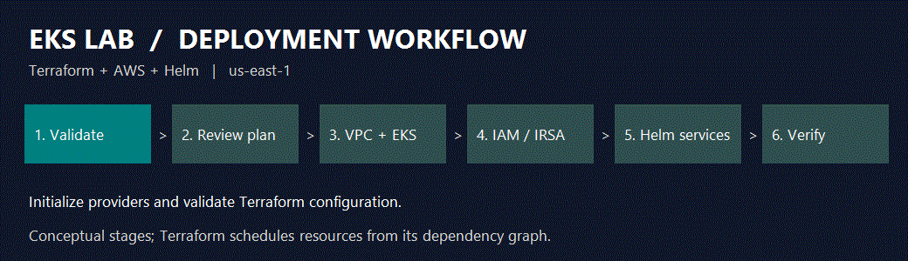
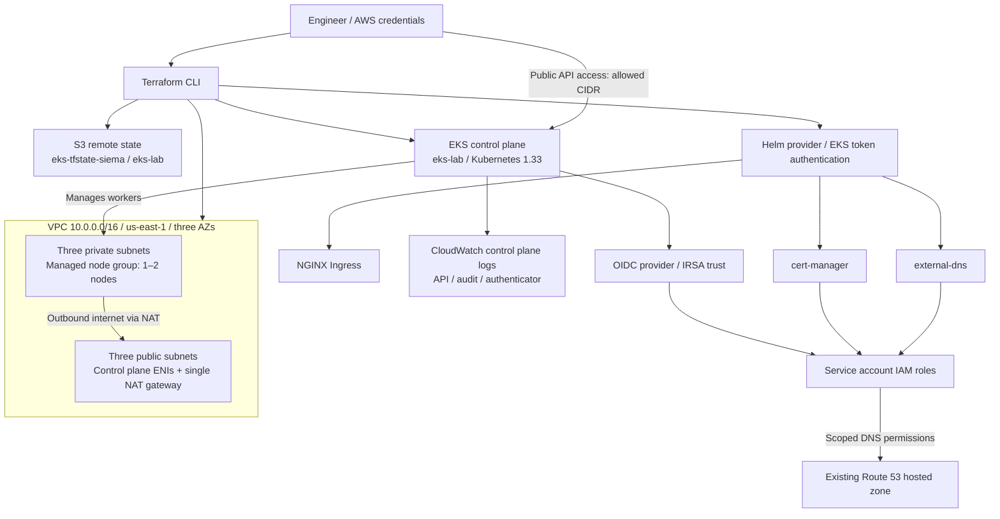
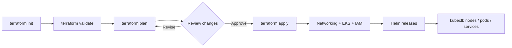
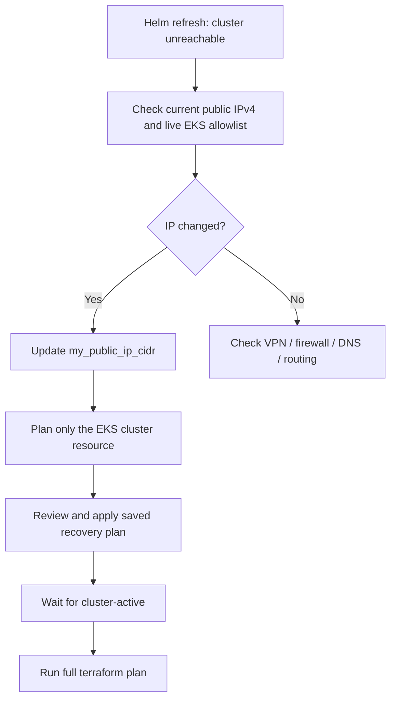

# EKS Kubernetes Lab

An infrastructure-as-code lab for Amazon EKS, combining Terraform-managed
networking and IAM with Helm-managed Kubernetes services.

**Stack:** AWS EKS · Terraform · Helm · NGINX Ingress · cert-manager · external-dns

## Deployment at a glance



The animation shows conceptual stages. Terraform schedules resources using its
dependency graph; independent operations can run in parallel. It is an overview,
not a live deployment status indicator.

## Architecture



The diagram shows resource relationships and access paths. The managed node
group starts with **one node**, so three subnet AZs do not imply application
replicas across three AZs. The single NAT gateway is a lab cost tradeoff.

## How a deployment runs



## Scope and observability

This repository provisions cluster infrastructure and platform services. It does
not currently define an application Deployment, Service, Ingress, or certificate
resource. Installing the controllers prepares those capabilities; application
routing and certificate issuance still need their own Kubernetes resources.

The installed EKS module defaults enable API, audit, and authenticator logs in
CloudWatch. Application log collection, Prometheus/Grafana dashboards,
distributed tracing, and alert rules are not configured here.

## What this project creates

- An EKS cluster named `eks-lab` in `us-east-1`, running Kubernetes `1.33`.
- A VPC with three public and three private subnets across three availability
  zones, plus a single NAT gateway.
- One EKS managed node group using `m7i-flex.large` instances. It can scale
  between one and two nodes.
- The `vpc-cni`, `eks-pod-identity-agent`, `kube-proxy`, and `coredns` EKS
  add-ons. The VPC CNI and Pod Identity Agent are installed before compute.
- IAM Roles for Service Accounts (IRSA), including roles for `cert-manager`
  and `external-dns`.

The EKS API endpoint is public and restricted to `my_public_ip_cidr` in
`variables.tf`. Set this to your own public IPv4 address followed by `/32`
before deploying from another network.

## Prerequisites

- Terraform CLI (version 1.0 or later).
- AWS CLI and `kubectl`.
- AWS credentials with permissions to manage the resources in this project.
- The S3 bucket `eks-tfstate-siema` in `us-east-1` must already exist and be
  accessible to your AWS identity; Terraform uses it for remote state.

Configure credentials using an AWS CLI profile or the standard AWS environment
variables. For example, in Git Bash:

```bash
export AWS_PROFILE=your-profile
aws sts get-caller-identity
```

Terraform does not load `.env` files automatically. Do not commit access keys
or other credentials to the repository.

## Deploy

Run these commands from this directory:

```bash
terraform init
terraform validate
terraform plan
terraform apply
```

Review the plan before approving the apply. Terraform downloads provider
versions according to the configuration and `.terraform.lock.hcl`.

After deployment, configure `kubectl` and check the cluster:

```bash
aws eks update-kubeconfig --region us-east-1 --name eks-lab
kubectl get nodes
kubectl get pods --all-namespaces
```

## Recover access after your public IP changes



If `terraform plan` fails with `Kubernetes cluster unreachable` while refreshing
Helm releases, check whether your current public IP differs from the cluster's
allowlist. A normal plan must contact Kubernetes before it can apply the new
allowlist, so changing the variable alone does not restore access.

From the same terminal and network used to run Terraform, find your public IPv4:

```bash
curl -4 https://checkip.amazonaws.com
```

Set `my_public_ip_cidr` in `variables.tf` to that address followed by `/32`.
Then plan only the EKS cluster resource, review the saved plan, and apply it:

```bash
terraform plan -target='module.eks.aws_eks_cluster.this[0]' -out=endpoint-access.tfplan
terraform apply endpoint-access.tfplan
```

Wait for the update to finish, then run a full plan to refresh Helm releases and
check the remaining changes:

```bash
aws eks wait cluster-active --region us-east-1 --name eks-lab
terraform plan
```

Targeting is a recovery step; use full plans for normal deployments. If access
still fails, inspect the live allowlist with the command below and check your
VPN, firewall, and network routing (including DNS64/NAT64 if the error shows an
address starting with `64:ff9b::`):

```bash
aws eks describe-cluster --region us-east-1 --name eks-lab --query 'cluster.resourcesVpcConfig'
```

## Route 53 / IRSA configuration

`irsa.tf` grants the `cert-manager` and `external-dns` service accounts
permissions scoped to the Route 53 hosted zone ARN configured there. Replace
that ARN with the hosted zone you intend to use before deploying these roles.
The Kubernetes service accounts must use the matching namespaces and names:

- `cert-manager:cert-manager`
- `external-dns:external-dns`

## Tear down

To delete the resources managed by this configuration:

```bash
terraform destroy
```

Review the destroy plan carefully. This removes the EKS cluster and associated
networking and IAM resources; it does not delete the separately managed S3
state bucket.

Keep AWS credentials and cluster connectivity working during teardown so Helm
can uninstall its releases. Resources created separately, such as the Route 53
hosted zone and S3 backend bucket, remain outside this project's teardown.

## Repository guide

- `providers.tf`: provider requirements, S3 backend, and Helm authentication.
- `vpc.tf`: subnet layout, NAT gateway, and networking tags.
- `eks.tf`: cluster, managed node group, access settings, and EKS add-ons.
- `irsa.tf`: service account trust and Route 53 IAM permissions.
- `helm.tf` and `helm-values/`: platform charts and their configuration.
- `variables.tf` and `locals.tf`: endpoint allowlist and shared settings.
- `scripts/render-workflow.ps1`: regenerate the README animation on Windows.

To regenerate the animation from this directory:

```powershell
powershell -NoProfile -ExecutionPolicy Bypass -File scripts/render-workflow.ps1
```

This sets the execution policy for that process only.

Terraform state, saved plans, local variable files, and `.env` files are excluded
by `.gitignore`. Review staged files before committing.
